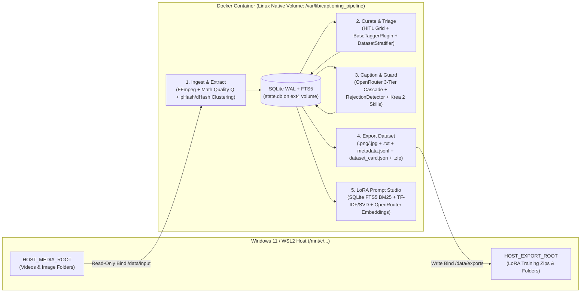

# Captioning Pipeline & LoRA Dataset Studio — Architecture Blueprint

> **Document Version:** 2.0.0  
> **Target Environment:** Docker Compose on Windows 11 + WSL2 (Linux Backend Container)  
> **Core Principle:** Zero Heavy Local GPU/ML Model Dependencies by Default (Pure Mathematical CV + FFmpeg + OpenRouter API Cascade + Pluggable Strategy Interfaces)

---

## 1. Audit of Legacy Repository (`/home/z3pp1x/code/captioning_pipeline`)

### 1.1 Repository & Adjacent Workspace Inspection
- **`/home/z3pp1x/code/captioning_pipeline`**: Contains a 16-commit full-stack application (`src/pipeline/*` FastAPI backend + `src/web/*` Angular 22 / Spartan UI frontend, 22 Pytest test modules, and 38 utility scripts).
- **`/home/z3pp1x/code/lora-video-pipeline`**: Inspected; contains only empty placeholder directories (`app.py/`, `config/`, `core/`) with no source files. All active logic resides in `captioning_pipeline`.

### 1.2 Module-by-Module Audit: Reuse vs. Refactor vs. Deprecate

| Legacy File / Module | Current Responsibility | Audit Verdict | Architectural Action & Rationale |
| :--- | :--- | :--- | :--- |
| `src/pipeline/metrics.py` | 4x4 tile Laplacian variance, exposure/clipping checks, Shannon entropy $H(I)$, 64-bit DCT `compute_phash`, 64-bit gradient `compute_dhash`, Hamming distance. | **REUSE & EXTEND** | Core mathematical CV primitives are fast (~4.5 ms/frame at 512px) and dependency-light. Extend with **Tenengrad gradient magnitude** ($G_x^2 + G_y^2$), **HSV color histogram distance**, and **$O(N \log N)$ Vantage-Point / BK-tree or prefix-bucketed hash clustering** instead of $O(N^2)$ linear scans. |
| `src/pipeline/quality.py` | Hard quality gates (`border_black_fraction`, `too_dark`, `blown_out`, `clipping`, `blur`), Immerkaer fast noise $\sigma$ estimator, percentile normalization. | **REUSE & REFACTOR** | Keep hard gates, letterbox bar detection, and Immerkaer noise estimation. Strip out the `IqaScorer` (`topiq_nr` ONNX download from HuggingFace and `clip_iqa` ONNX session) from the core path; move optional neural IQA behind the `BaseTaggerPlugin` / optional plugin boundary. |
| `src/pipeline/decode.py` & `cuts.py` | PyAV container demuxing, window-peak sub-sampling (`pick_window_peak`), exact PTS cluster seeking (`decode_exact_frames`), HSV adaptive cut detection (`detect_content_cuts`). | **REUSE & AUGMENT** | Excellent low-memory frame decoding and window-peak sharpness/motion selection. Augment with **Path 1 (Pre-sorted Image Folder Ingestion)** and **Path 2 (FFmpeg Subprocess Scene Filter `select='gt(scene,0.15)'` + I-Frame `select='eq(pict_type,I)'` + FPS Interval)** for high-speed non-ML extraction. |
| `src/pipeline/openrouter.py` & `prompts/*` | Async `httpx` client, 512px base64 JPEG downscaling (`prepare_512px_payload`), `usage: {include: true}` cost tracking, 3-layer cascade, refusal/preamble/residue regexes, versioned Krea 2 Markdown prompts (`character.md`, `concept.md`, `style.md`, `glossary.md`). | **REUSE & UPGRADE** | Strong foundation. Refactor into formal **`OpenRouterCascadeEngine`**, **`SkillRegistry`** (database-backed versionable skills seeded from `prompts/*.md`), and deterministic **`RejectionDetector`** with configurable triggerword positioning (`prefix`, `suffix`, `natural_integration`) and `"needs_manual_caption"` fallback status. |
| `src/pipeline/export.py` & `captions.py` | Lanczos max-edge clamping, crop/letterbox/watermark stripping, multiple-of-16 latent grid snapping (`snap_to_multiple_of_16`), `.png` + `.txt` + `manifest.jsonl` generation, hard-link deduplication. | **REUSE & EXPAND** | High-value deterministic image pipeline. Expand `Exporter` to support both video-derived and standalone image datasets, `.png`/`.jpg` format selection, `metadata.jsonl`, `dataset_card.json` (audit & distribution summary), and streaming `.zip` archive download. |
| `src/pipeline/rag/*` (`indexer.py`, `retriever.py`, `generator.py`, `linter.py`, `taxonomy.py`) | 4-domain sentence segmentation (`equipment`, `surroundings`, `position`, `camera_lighting`), SQLite FTS5 BM25 search (`rag_captions_fts`), Reciprocal Rank Fusion (`_rrf_fuse`), MMR diversity, 3-archetype Krea 2 prompt synthesis & linting. | **REFACTOR (DECOUPLE ONNX)** | Keep FTS5 BM25, 4-domain taxonomy segmentation, RRF fusion, MMR diversification, and Krea 2 prompt linter/generator. **Replace** the mandatory local `ClipClassifier` / `SigLIP` ONNX embedders with **Tier 1 (SQLite FTS5 BM25 + Tag/Metadata Filtering)** and **Tier 2 (Local `scikit-learn` TF-IDF + TruncatedSVD 128-D LSA vectors or optional OpenRouter Embeddings API)**. |
| `src/pipeline/classifier.py`, `embedders.py`, `face.py`, `image_tags.py`, `tagger.py` | Local ONNX Runtime sessions (`Xenova/clip-vit-base-patch32`, `DINOv2`, `SigLIP`, `YuNet`, `SFace`) baked into Docker image (~300 MB+). | **DEPRECATE FROM CORE -> PLUGIN** | **Major Technical Debt:** Violates the Zero-Local-ML constraint, bloats Docker builds, and couples curation/scoring to specific ONNX weights. Extract into optional plugins implementing `BaseTaggerPlugin` (`RuleBasedHeuristicPlugin` as default; `ClipOnnxPlugin` / `WD14OnnxPlugin` as optional drop-ins). |
| `src/pipeline/db.py` | Single-file SQLite wrapper with WAL mode, ad-hoc `ALTER TABLE` migrations, video-only schema (`videos`, `chunks`, `frames`, `picks`). | **REPLACE SCHEMA, KEEP WAL PATTERN** | Current schema cannot represent standalone image folders (`Pre-sorted Images` path), general `datasets`, perceptual hash `clusters`, versioned `skills`, `caption_history`, or `rejection_logs`. Replace with the unified 12-table SQLite WAL + FTS5 schema while preserving thread-safe serialized write transactions. |
| `src/pipeline/api.py` & `jobs.py` | 2,255-line monolithic FastAPI router + 2,432-line monolithic `JobManager` with SSE queue broadcasting. | **MODULARIZE** | Keep the thread-safe SSE broadcast pattern (`loop.call_soon_threadsafe`) and job cancellation checkpoints, but split into clean domain routers (`ingest`, `triage`, `captioning`, `export`, `rag`, `settings`) and domain services under `/backend/app/`. |
| `scripts/*` (38 scripts) | Ad-hoc repair scripts (`repair_sandra.py`, `start_jynx_extract.py`, `start_madeline_caption.py`, `cleanup_stuck_status.py`). | **ARCHIVE / REMOVE** | Hardcoded dataset names and one-off DB patches are technical debt. Retain only clean operational scripts (`reset_db.sh`, `verify_wsl.sh`). |
| `Dockerfile` & `docker-compose.yml` | Hardcoded personal Windows paths (`/mnt/c/Users/Patri/Videos/_girls`), mandatory `download_models.py` during `docker build`, host-mounted SQLite cache dir. | **REDESIGN** | Eliminate hardcoded user paths, remove mandatory ONNX downloads at build time, and move SQLite WAL + thumbnails + extracted frames onto a **named native Docker volume** (`pipeline_appdata`) to eliminate WSL2 9P filesystem locking and I/O bottlenecks. |

---

## 2. Clean Monorepo Directory Structure

```text
captioning_pipeline/
├── ARCHITECTURE.md                       # Root Architecture Blueprint (mirrored in docs/ARCHITECTURE.md)
├── README.md                             # Quickstart, WSL2 setup, and workflow documentation
├── .env.example                          # Clean environment template (HOST_MEDIA_ROOT, OPENROUTER_API_KEY, etc.)
├── docker-compose.yml                    # Production & WSL2-optimized compose definition
├── pyproject.toml                        # Python 3.12 backend dependencies (FastAPI, OpenCV, NumPy, scikit-learn, httpx)
├── package.json                          # Frontend workspace / Angular 22 + Tailwind v4 dependencies
│
├── docker/
│   ├── Dockerfile.backend                # Lightweight Python 3.12 + FFmpeg + SQLite3 runtime (Zero local ML bloat)
│   ├── Dockerfile.frontend               # Multi-stage Node 22 build + Nginx/FastAPI static bundle
│   └── entrypoint.sh                     # Volume permission check, WAL initialization, and uvicorn launcher
│
├── docs/
│   ├── ARCHITECTURE.md                   # Symlink or copy of root ARCHITECTURE.md
│   └── reviews/                          # Historical design & pipeline review notes
│
├── backend/                              # Clean modular Python backend (coexists with legacy src/pipeline during migration)
│   ├── app/
│   │   ├── __init__.py
│   │   ├── main.py                       # FastAPI app factory, lifespan, CORS, and SSE/WS mount
│   │   ├── config.py                     # Pydantic Settings + environment variable bindings
│   │   ├── db/
│   │   │   ├── __init__.py
│   │   │   ├── schema.sql                # Canonical DDL (WAL, Foreign Keys, 12 core tables + FTS5)
│   │   │   ├── session.py                # Thread-safe SQLite WAL connection pool & write lock manager
│   │   │   └── seed.py                   # Default system settings & Krea 2 Master Skills seeder
│   │   ├── models/
│   │   │   ├── __init__.py
│   │   │   ├── domain.py                 # Dataclasses / Pydantic schemas for Tag, MediaItem, Cluster, Skill
│   │   │   └── api_schemas.py            # Request/Response DTOs for REST & SSE/WebSocket events
│   │   ├── modules/
│   │   │   ├── ingestion/                # Module A: Image Folder Scanner, FFmpeg Scene/I-Frame Extractor, CV Scorer, Hash Clusterer
│   │   │   │   ├── extractor.py          # FFmpeg subprocess & PyAV extraction (Scene, I-Frame, Interval)
│   │   │   │   ├── quality_math.py       # Laplacian + Tenengrad sharpness, Histogram clipping, Shannon entropy
│   │   │   │   └── deduplicator.py       # pHash + dHash + HSV histogram O(N log N) clustering & representative selection
│   │   │   ├── curation/                 # Module B: HITL Triage, Tagging Plugins, and Dataset Stratification
│   │   │   │   ├── interfaces.py         # Abstract BaseTaggerPlugin & DatasetStratifier
│   │   │   │   ├── rule_tagger.py        # Default non-ML rule-based heuristic tagger (aspect, luma, color temp, shot scale proxy)
│   │   │   │   └── stratifier.py         # Rule-based & plugin-ready stratification & outlier detection
│   │   │   ├── captioning/               # Module C: OpenRouter 3-Tier Cascade, Skills, and Rejection-Guard
│   │   │   │   ├── cascade.py            # Primary -> Fallback 1 -> Fallback 2 async dispatcher
│   │   │   │   ├── rejection_guard.py    # Deterministic RejectionDetector (length, regex refusal, meta-talk, truncation)
│   │   │   │   └── skills.py             # Versioned Master Skills (Krea 2 Character, Concept, Style) & Triggerword injector
│   │   │   └── export_rag/               # Module D: Dataset Exporter & Local Non-ML LoRA-RAG Pipeline
│   │   │       ├── exporter.py           # Image normalization, .txt pairing, metadata.jsonl, dataset_card.json, .zip
│   │   │       ├── rag_engine.py         # Tier-1 SQLite FTS5 BM25 + Tier-2 TF-IDF/SVD & OpenRouter Embedding hybrid retrieval
│   │   │       └── prompt_studio.py      # Grounded prompt generation & Krea 2 token/sludge linter
│   │   └── api/
│   │       ├── router.py                 # Master API router (/api/v1/* and legacy compatibility aliases)
│   │       ├── events.py                 # SSE (/api/v1/events/stream) and WebSocket (/api/v1/ws) manager
│   │       └── endpoints/                # Step 1..5 modular route handlers
│   └── tests/                            # Unit & integration tests for mathematical CV, Rejection-Guard, FTS5 RAG, and API
│
├── frontend/                             # Stepper-guided Studio UI (migrated/linked with src/web Angular 22 app)
│   └── ...
└── src/                                  # Preserved existing codebase for backward compatibility & incremental cutover
```

---

## 3. Core Architecture & Module Specifications



---

### 3.1 Module A: Ingestion & Non-ML Frame Extraction

#### A.1 Dual Ingestion Paths
1. **Path 1 — Pre-sorted Images (`source_type = 'image_folder'`)**:
   - Recursively scans a folder under `/data/input/<folder>` for `.png`, `.jpg`, `.jpeg`, `.webp`.
   - Validates image header integrity, extracts native dimensions $(W, H)$, aspect ratio $W/H$, file hash (SHA-256 prefix), and existing sidecar `.txt` captions if present.
   - Generates a 384px WebP thumbnail on the native Linux Docker volume (`/var/lib/captioning_pipeline/thumbnails`) so the UI never reads multi-megabyte raw files across the WSL2 mount during triage.
2. **Path 2 — Raw Videos (`source_type = 'video'`)**:
   - Uses `ffprobe` / PyAV to extract container metadata (`duration_s`, `fps`, `width`, `height`, `codec`, `pix_fmt`).
   - Supports three deterministic, non-ML FFmpeg extraction modes configurable per job:
     - **Scene-Change Detection (`mode = 'scene'`)**: Executes FFmpeg filtergraph:
       ```bash
       ffmpeg -nostdin -hwaccel auto -i <input_video> \
         -vf "select='gt(scene,0.15)',showinfo" -vsync vfr -q:v 2 <frame_pattern>
       ```
       Combined with adaptive HSV content delta (`cuts.py`: $|\Delta H| + |\Delta S| + |\Delta V| \ge 15.0$, adaptive window ratio $\ge 3.0$) and minimum scene separation $\Delta t_{\min} \ge 0.5\text{s}$.
     - **I-Frame / Keyframe Extraction (`mode = 'iframe'`)**:
       ```bash
       ffmpeg -nostdin -skip_frame nokey -i <input_video> -vsync vfr -q:v 2 <frame_pattern>
       ```
     - **Interval + Window-Peak Sampling (`mode = 'interval'`)**:
       Samples every $\Delta t = 1 / f_{\text{sample}}$ seconds (e.g., $0.25\text{s}$ to $2.0\text{s}$), taking $M=3$ sub-samples per window and selecting the frame maximizing $\frac{S_{\text{lap}}}{\max S_{\text{lap}}} - 0.5 \frac{E_{\text{motion}}}{\max(E_{\text{motion}}, 2.0)}$.

#### A.2 Mathematical Quality Scoring ($Q \in [0, 1]$) — Zero ML
Every ingested image or extracted video frame (downscaled to longest edge $512\text{px}$ in luminance $I \in [0, 255]^{H \times W}$) is evaluated in $<5\text{ ms}$ using four pure mathematical signals:

1. **Sharpness Score $S(I) \in [0, 1]$ (Laplacian Variance + Tenengrad Gradient)**:
   - **Tile Laplacian Variance ($L_{\text{tile}}$)**: Compute $\nabla^2 I$ via $3 \times 3$ Laplacian kernel across a $4 \times 4$ spatial grid. To handle shallow depth-of-field (bokeh background with sharp subject), take the mean variance of the top-3 sharpest tiles, minus Immerkaer flat-region sensor noise $20\hat{\sigma}_{\text{noise}}^2$:
     $$L_{\text{tile}}(I) = \max\left(0, \frac{1}{3}\sum_{k=1}^{3} \text{Var}(\nabla^2 I)_{(17-k)} - 20\hat{\sigma}_{\text{noise}}^2\right)$$
   - **Tenengrad Sobel Energy ($T(I)$)**: Compute horizontal and vertical Sobel gradients $G_x = S_x * I$, $G_y = S_y * I$ over the central $60\%$ subject region $\Omega_c$:
     $$T(I) = \frac{1}{|\Omega_c|} \sum_{(x,y) \in \Omega_c} \left(G_x(x,y)^2 + G_y(x,y)^2\right)$$
   - **Combined Normalized Sharpness**:
     $$S_{\text{norm}}(I) = 0.60 \cdot \min\left(1.0, \frac{L_{\text{tile}}(I)}{L_{\text{ref}}}\right) + 0.40 \cdot \min\left(1.0, \frac{\sqrt{T(I)}}{T_{\text{ref}}}\right)$$
     where $L_{\text{ref}} = 350.0$, $T_{\text{ref}} = 45.0$ (or blended $0.7 \cdot \text{percentile}_{\text{chunk}} + 0.3 \cdot \text{percentile}_{\text{dataset}}$ when batch size $\ge 8$).

2. **Exposure & Clipping Score $E(I) \in [0, 1]$**:
   - **Histogram Clipping Fraction**:
     $$c_{\text{black}} = \frac{1}{HW}\sum_{x,y} \mathbb{I}(I(x,y) < 5), \qquad c_{\text{white}} = \frac{1}{HW}\sum_{x,y} \mathbb{I}(I(x,y) > 250), \qquad c_{\text{total}} = c_{\text{black}} + c_{\text{white}}$$
   - **Mean Luminance & Chiaroscuro-Aware Balance**: Let $\mu_I = \frac{1}{HW}\sum I(x,y)$ and $\sigma_I = \sqrt{\text{Var}(I)}$. Standard target is $\mu_{\text{target}} = 128$; for high-contrast low-key studio lighting ($\mu_I < 128$ and $\sigma_I \ge 35$), $\mu_{\text{target}} = 95$:
     $$E_{\text{norm}}(I) = \max\left(0.0, 1.0 - 0.5\frac{|\mu_I - \mu_{\text{target}}|}{128.0} - 1.5 c_{\text{total}}\right)$$

3. **Information Density / Shannon Entropy $H_{\text{norm}}(I) \in [0, 1]$**:
   - Given normalized 256-bin luminance histogram $p_k = \frac{n_k}{HW}$ for $k \in \{0, \dots, 255\}$:
     $$H(I) = -\sum_{k: p_k > 0} p_k \log_2(p_k) \in [0, 8], \qquad H_{\text{norm}}(I) = \min\left(1.0, \frac{H(I)}{7.5}\right)$$

4. **Contrast Score $C_{\text{norm}}(I) \in [0, 1]$**:
   - Root-mean-square contrast normalized against reference $\sigma_{\text{ref}} = 60.0$:
     $$C_{\text{norm}}(I) = \min\left(1.0, \frac{\sigma_I}{60.0}\right)$$

5. **Composite Quality Score $Q(I) \in [0, 1]$ & Hard Gates**:
   - **Hard Rejection Gates**: Any frame with $\mu_I < 10.0$ (`too_dark`), $\mu_I > 248.0$ (`blown_out`), $c_{\text{total}} > 0.40$ (`severe_clipping`), border black fraction $> 0.45$ (`letterbox_card`), or $L_{\text{tile}}(I) < 15.0$ (`motion_blur`) is automatically flagged `status = 'auto_rejected'` with `reject_reason`.
   - **Composite Formula**:
     $$Q(I) = \text{clip}_{[0,1]}\Big(w_S S_{\text{norm}}(I) + w_E E_{\text{norm}}(I) + w_H H_{\text{norm}}(I) + w_C C_{\text{norm}}(I)\Big)$$
     with default weights $(w_S, w_E, w_H, w_C) = (0.45, 0.25, 0.15, 0.15)$ (user-tunable in `system_settings`).

#### A.3 Fast $O(N \log N)$ Deduplication & Clustering
- **Multi-Hash Fingerprint**:
  1. **64-bit pHash ($h_p$)**: $32 \times 32$ grayscale resize $\to$ 2D DCT $\to$ top-left $8 \times 8$ low-frequency coefficients compared against median.
  2. **64-bit dHash ($h_d$)**: $9 \times 8$ grayscale resize $\to$ horizontal adjacent pixel comparison $I(x+1, y) > I(x, y)$.
  3. **24-bin HSV Color Histogram ($v_{\text{hsv}} \in \mathbb{R}^{24}$)**: L2-normalized $(8\text{ H} + 8\text{ S} + 8\text{ V})$ histogram to disambiguate structurally similar silhouettes with different lighting/color.
- **Sub-Quadratic Clustering Algorithm ($O(N \log N)$)**:
  - Instead of naive $O(N^2)$ pairwise comparisons:
    1. **Pass 1 (Temporal Window Stream)**: Sort items by `(source_video_id, timestamp_s)` or filename and collapse consecutive frames with $d_H(h_d^{(i)}, h_d^{(i-1)}) \le \tau_d$ in $O(N)$.
    2. **Pass 2 (Multi-Index Prefix Bucketing / BK-Tree)**: Partition the 64-bit pHash into $m = 4$ 16-bit band prefixes (Pigeonhole Principle for Hamming distance $\tau \le 8$) and index into a BK-Tree (metric tree over discrete Hamming metric $d_H(h_1, h_2) = \text{popcount}(h_1 \oplus h_2)$). Lookup per item takes $O(\log N)$ average time.
    3. **Cluster Formation**: Items within $d_H(h_p^{(i)}, h_p^{(j)}) \le \tau_p$ (default $\tau_p = 6$) and $d_H(h_d^{(i)}, h_d^{(j)}) \le \tau_d$ (default $\tau_d = 8$) and $\cos(v_{\text{hsv}}^{(i)}, v_{\text{hsv}}^{(j)}) \ge 0.85$ are grouped via Union-Find into a `cluster_id`.
    4. **Best-Representative Selection**: Within each cluster $C_k$, select the representative item:
       $$i^* = \arg\max_{i \in C_k} Q(I_i)$$
       Mark $i^*$ with `is_cluster_representative = 1` and `curation_state = 'keep'`, while sibling items $i \in C_k \setminus \{i^*\}$ are linked to `cluster_id` with `curation_state = 'duplicate_hidden'` (expandable in the UI cluster drawer for manual override).

---

### 3.2 Module B: HITL Curation & ML-Ready Stratification

#### B.1 Unified `Tag` Domain Model
```python
from typing import Literal
from pydantic import BaseModel, Field

TagSource = Literal["manual", "rule", "ml_plugin"]
TagCategory = Literal["pose", "lighting", "outfit", "expression", "style_element", "shot_scale", "environment", "equipment"]

class Tag(BaseModel):
    name: str = Field(..., min_length=1, max_length=64)
    slug: str
    source: TagSource = "manual"
    category: TagCategory = "style_element"
    confidence: float = Field(default=1.0, ge=0.0, le=1.0)
    bbox: dict[str, float] | None = None  # Optional normalized {x, y, w, h}
```

#### B.2 Strategy / Plugin Interfaces (`BaseTaggerPlugin` & `DatasetStratifier`)

```python
from abc import ABC, abstractmethod
from typing import Any
import numpy as np
from backend.app.models.domain import Tag

class BaseTaggerPlugin(ABC):
    """Abstract interface for both Non-ML Rule Taggers and future ML Taggers (WD14, CLIP, SigLIP, JoyTag)."""

    @property
    @abstractmethod
    def plugin_id(self) -> str:
        """Unique identifier, e.g. 'rule_cv_heuristics', 'wd14_swinv2_onnx', 'siglip_zero_shot'."""

    @property
    @abstractmethod
    def requires_ml_runtime(self) -> bool:
        """False for pure OpenCV/NumPy heuristics; True for ONNX/PyTorch plugins."""

    @abstractmethod
    def is_available(self) -> bool:
        """Returns True if weights/dependencies are present without raising import errors."""

    @abstractmethod
    def analyze_item(self, img_bgr: np.ndarray, metadata: dict[str, Any]) -> list[Tag]:
        """Analyze a single BGR image + metadata dict and return structured Tag predictions."""

    def analyze_batch(self, items: list[tuple[np.ndarray, dict[str, Any]]]) -> list[list[Tag]]:
        """Batch entrypoint; subclasses with GPU/ONNX batching can override."""
        return [self.analyze_item(img, meta) for img, meta in items]


class DatasetStratifier(ABC):
    """Analyzes dataset balance, detects visual/tag outliers, and recommends keep/reject adjustments."""

    @abstractmethod
    def compute_distribution(self, media_items: list[dict[str, Any]], tags_by_item: dict[int, list[Tag]]) -> dict[str, Any]:
        """Returns histogram buckets across aspect ratio, lighting/brightness, color temperature,
        temporal spread (for video sources), and TagCategory coverage."""

    @abstractmethod
    def detect_outliers_and_gaps(self, distribution: dict[str, Any], target_size: int) -> dict[str, Any]:
        """Identifies over-represented clusters/buckets, under-represented categories, and quality outliers."""

    @abstractmethod
    def stratify_selection(
        self,
        media_items: list[dict[str, Any]],
        tags_by_item: dict[int, list[Tag]],
        target_count: int,
        diversity_weight: float = 0.5,
    ) -> dict[str, list[int]]:
        """Returns {'recommended_keep_ids': [...], 'recommended_demote_ids': [...], 'outlier_ids': [...]}."""
```

#### B.3 Default Non-ML Implementation (`RuleBasedHeuristicPlugin` & `RuleBasedStratifier`)
Without loading any neural network:
- **Aspect Ratio & Framing Proxy (`category = 'shot_scale'`)**: Classifies `portrait_tall` ($W/H < 0.8$), `square` ($0.8 \le W/H \le 1.2$), `landscape_wide` ($W/H > 1.2$), and edge-density center-vs-periphery ratio (high central Sobel energy vs. blurred periphery $\to$ `close_focus_bokeh` vs. `full_scene_deep_dof`).
- **Lighting & Brightness Key (`category = 'lighting'`)**: Classifies luminance distribution into `low_key_dark` ($\mu_I < 75, \sigma_I < 40$), `chiaroscuro_high_contrast` ($\mu_I < 115, \sigma_I \ge 45$), `balanced_midtone` ($75 \le \mu_I \le 180$), and `high_key_bright` ($\mu_I > 180$).
- **Color Temperature & Saturation (`category = 'style_element'`)**: Computes CIE LAB $b^*$ (yellow-blue) and $a^*$ (red-green) channel means plus HSV saturation $\mu_S$: tags `warm_tungsten_cast`, `cool_daylight_cast`, `monochrome_desaturated` ($\mu_S < 18$), or `vivid_saturated` ($\mu_S > 110$).
- **Temporal & Cluster Spread**: Stratifies video frames across timeline deciles $[0.0, 0.1, \dots, 1.0]$ and perceptual hash distance to guarantee uniform temporal and visual coverage.

---

### 3.3 Module C: OpenRouter Captioning Engine & Rejection-Guard

#### C.1 Configuration & 3-Model Cascade
- **API Key Resolution Priority**:
  1. Explicit request header/payload override (for one-off testing).
  2. Encrypted/redacted SQLite `system_settings` key (`openrouter_api_key`).
  3. Environment variable `OPENROUTER_API_KEY` from `.env`.
- **3-Tier Model Cascade**:
  - `primary_model` (Layer 1): Default `google/gemma-4-31b-it` (or user-selected VLM, e.g., `qwen/qwen-2.5-vl-72b-instruct`).
  - `fallback_model_1` (Layer 2): Default `deepseek/deepseek-v4.1-flash` (invoked automatically when Layer 1 refuses, truncates, or fails validation).
  - `fallback_model_2` (Layer 3): Default `x-ai/grok-4.7` (uncensored/high-reliability final fallback).
- **Sampling & Token Controls**:
  - `max_tokens` $\in [64, 4096]$ (default `600`; automatically boosted to $\ge 1200$ if `reasoning_effort` is enabled).
  - `temperature` $\in [0.0, 2.0]$ (default `0.4` for dataset consistency).
  - `top_p` $\in [0.0, 1.0]$ (default `0.90`).
  - `max_image_dim` $\in [256, 2048]$ (default `512`px JPEG Q85 payload to minimize vision token cost while preserving composition).

#### C.2 Triggerword Management
- Configurable `trigger_word` (e.g., `ohwx_woman`, `restrained_elegance`) and `trigger_position`:
  - **`prefix`**: Guarantees exact placement at Token 0 (`"{trigger_word}, ..."` or `"{trigger_word} Photograph of ..."`).
  - **`suffix`**: Appends cleanly at the end of the caption (`"... , {trigger_word}."`).
  - **`natural_integration`**: Instructs the VLM system prompt to weave `{trigger_word}` naturally into the opening subject clause and verifies single occurrence via regex post-check.

#### C.3 Versionable Master Skills (`skills` Table)
Pre-seeded from the existing tested templates (`src/pipeline/prompts/*.md`) and editable/versionable in the UI:
1. **Skill 1 — `krea2_character_training` (Krea 2 Character Training)**:
   - **Rule**: Token 0 anchor `"{trigger} Photograph of a {class_noun}..."`.
   - **Identity Decoupling**: Strictly forbids describing permanent facial geometry (eye shape, nose shape, bone structure, ethnicity) so those features bind to `{trigger}`.
   - **Primary Focus**: Exhaustively describes mutable context: outfit, fabrics, restraints/props, hairstyle, pose, lighting, and camera angle in $80\text{--}140$ words of flowing prose.
2. **Skill 2 — `krea2_concept_style_training` (Krea 2 Concept & Style Training)**:
   - **Concept Mode**: Token 0 anchor `"{trigger} Photograph of..."`. Explicitly describes the adult subject's apparent age range, build, and skin tone so identity is decoupled from the concept trigger. Details anatomical tension, materials/hardware, spatial setting, and optics ($120\text{--}180$ words).
   - **Style Mode (Content Inversion)**: Describes all objects, people, actions, and setting objectively while omitting style/color-grading/film-grain descriptors so the visual aesthetic binds entirely to `{trigger}` ($75\text{--}130$ words).

#### C.4 Deterministic `RejectionDetector` (Rejection-Guard)
Every VLM response is audited by `RejectionDetector.evaluate(raw_text, finish_reason, choice_metadata, skill_profile)` before acceptance:
1. **Provider Metadata Check**: Rejects immediately if `finish_reason in ("content_filter", "safety", "refusal")` or `message.refusal` is non-empty.
2. **Empty / Min-Length Check**: Rejects if stripped response is empty, $< 15$ words, or $< \text{hard\_min\_words}$ of the active skill.
3. **First-200-Char Normalized Refusal Regex**: Normalizes the first 200 characters (lowercase, smart-quote normalization) and matches against deterministic refusal patterns:
   ```python
   REFUSAL_HEAD_REGEX = re.compile(
       r"\b(?:i\s+(?:can(?:'t|not)|am\s+unable|must\s+decline|won't|will\s+not)|"
       r"sorry,?\s+(?:but\s+)?i\s+(?:can(?:'t|not)|am\s+unable)|"
       r"unable\s+to\s+(?:fulfill|assist|generate|describe|comply|provide)|"
       r"violates?\s+(?:our\s+)?(?:safety|content)\s+(?:policy|guidelines)|"
       r"as\s+an?\s+(?:ai|helpful|responsible)\s+(?:assistant|language\s+model)|"
       r"not\s+(?:appropriate|permitted|allowed)\s+(?:for\s+me\s+)?to\s+describe)\b",
       re.IGNORECASE,
   )
   ```
4. **Conversational Preamble & Meta-Talk Check**: Detects chatty wrappers (`"Here is a caption:"`, `"Sure! In this image..."`, `"This photograph shows..."`) and either strips benign leading labels or triggers a validation retry if conversational residue (`"I apologize"`, `"language model"`) appears mid-paragraph.
5. **Truncation & Sludge Sanitization**:
   - Strips Danbooru quality sludge (`masterpiece`, `8k`, `best quality`, `trending on artstation`) and WebUI bracket weights `(word:1.3)`.
   - Verifies terminal sentence punctuation (`.`, `!`, `?`). If `finish_reason == "length"` or sentence is cut off, retries once with `max_tokens * 2` and `reasoning` disabled before escalating to the next cascade model.
6. **Cascade Escalation & Fallback State**:
   - Every rejected attempt is logged to `rejection_logs` (`media_id`, `job_id`, `layer`, `model`, `rejection_type`, `raw_snippet`).
   - If `primary_model` $\to$ `fallback_model_1` $\to$ `fallback_model_2` all fail, the item is marked `caption_status = 'needs_manual_caption'` (never silently writing a refusal string into a training `.txt` file!) and surfaced in the UI's **"Needs Manual Caption"** filter tab.

---

### 3.4 Module D: Dataset Export & Local LoRA-RAG Pipeline

#### D.1 Standardized Dataset Exporter
Exports approved (`curation_state IN ('keep', 'star')`) and captioned (`caption_status IN ('approved', 'manual', 'vlm_accepted')`) items into `/data/exports/<dataset_slug>_<timestamp>/`:
1. **Image Normalization**:
   - Applies non-destructive crop / letterbox / watermark trim.
   - Clamps longest edge to `max_edge` (e.g., `1024` or `2048`) via Lanczos-4 interpolation (never upscales).
   - Optionally snaps dimensions $(W, H)$ to multiples of 16 (`snap_to_multiple_of_16`) for Flux / Krea 2 / SD3 / Wan DiT latent compatibility.
   - Writes clean, EXIF-stripped sRGB `.png` or `.jpg` (`<item_stem>.png`).
2. **Paired Caption Files**: Writes `<item_stem>.txt` with verified `trigger_word` placement.
3. **Structured Manifests**:
   - `metadata.jsonl`: HuggingFace / AI-Toolkit / Kohya compatible JSONL (`{"file_name": "0001.png", "text": "...", "width": 1024, "height": 1024, "tags": [...], "quality_score": 0.89}`).
   - `dataset_card.json`: Comprehensive audit report containing total items, resolution distribution, aspect ratio buckets, tag distribution, model cascade statistics, token length distribution, and triggerword configuration.
4. **Archive Packaging**: Optional one-click `.zip` generation (`<dataset_slug>.zip`) streamed or saved directly to `/data/exports/`.

#### D.2 Local Non-ML LoRA-RAG Pipeline & "LoRA Prompt Studio"
Powers the interactive **"LoRA Prompt Studio"** (Prompt Clicker & Generator) without requiring local GPU/ONNX models:
- **Tier 1 — Lexical & Structured Retrieval (Zero External Dependencies)**:
  - **SQLite FTS5 Virtual Table (`rag_fts`)**: Indexes `full_caption`, `equipment_text`, `surroundings_text`, `position_text`, `lighting_text`, and `tags_text` using Porter stemming (`tokenize='porter unicode61'`).
  - **BM25 Ranking**: Queries `bm25(rag_fts, 1.0, 0.6, 0.6, 0.6, 0.6, 0.8)` combined with exact `Tag` category filtering (`pose`, `lighting`, `outfit`, `expression`, `style_element`).
- **Tier 2 — Dense / Latent Semantic Retrieval (Local Non-ML Default + Optional API)**:
  - **Mode 2A — Local LSA (`scikit-learn` TF-IDF + TruncatedSVD, Default)**: Fits an in-memory/cached char+word n-gram `TfidfVectorizer(ngram_range=(1, 2), sublinear_tf=True)` + `TruncatedSVD(n_components=128)` over the dataset's captions (<150 ms for 5,000 captions, zero neural weights). Computes cosine similarity $\cos(\theta) = \frac{\mathbf{u} \cdot \mathbf{v}}{\|\mathbf{u}\|\|\mathbf{v}\|}$ in $\mathbb{R}^{128}$.
  - **Mode 2B — Optional OpenRouter Embeddings API**: When enabled by user setting, calls `POST https://openrouter.ai/api/v1/embeddings` (e.g., `openai/text-embedding-3-small` or `qwen/qwen3-embedding-8b`), caches float32 vectors in `rag_vectors`, and computes exact cosine similarity.
- **Hybrid Fusion & MMR Diversification**:
  - Combines Tag Overlap + FTS5 BM25 + Tier-2 Cosine Similarity via **Reciprocal Rank Fusion (RRF, $k=60$)**:
    $$\text{RRF}(d) = \sum_{m \in \{\text{tags}, \text{bm25}, \text{dense}\}} \frac{1}{60 + \text{rank}_m(d)}$$
  - Re-ranks top candidates via **Maximal Marginal Relevance (MMR)** ($\lambda = 0.7$) and `max_per_source` capping so retrieved grounding exemplars are diverse.
- **Prompt Studio Generation**:
  - Injects the top-$K$ retrieved dataset captions as grounding context into the selected OpenRouter LLM (`google/gemma-4-31b-it` or user choice) to generate 3 Krea 2 / Flux / SDXL prompt variants:
    - **Archetype A**: Concise comma-separated tag prompt ($25\text{--}50$ tokens).
    - **Archetype B**: Short anchor prose ($50\text{--}120$ tokens).
    - **Archetype C**: Dense visual narrative ($180\text{--}280$ tokens).

---

### 3.5 Module E: Docker & WSL2 Mount Architecture

#### E.1 Solving the WSL2 `/mnt/c` (9P / DrvFS) Performance & SQLite Locking Bottleneck
On Windows 11 with Docker Desktop (WSL2 backend), bind-mounting a Windows NTFS path (`/mnt/c/...`) uses the 9P protocol, which has:
1. High metadata/open latency on thousands of small thumbnail and frame files.
2. Unreliable POSIX `fcntl`/`flock` shared-memory semantics required by SQLite WAL (`state.db-shm` and `state.db-wal`), causing `sqlite3.OperationalError: disk I/O error` or `database is locked`.

#### E.2 Two-Tier Volume Topology
```yaml
# docker-compose.yml architecture
volumes:
  pipeline_appdata:
    driver: local  # Resides on native Linux ext4 inside the WSL2 Docker VM!
```
1. **Host Bind Mounts (Large Sequential I/O Only)**:
   - `${HOST_MEDIA_ROOT}:/data/input:ro` — Read-only access to raw source videos and pre-sorted image folders on Windows/WSL2.
   - `${HOST_EXPORT_ROOT}:/data/exports:rw` — Write access for finalized dataset exports (`.zip`, `metadata.jsonl`, normalized training images).
2. **Named Linux Native Volume (`pipeline_appdata:/var/lib/captioning_pipeline`)**:
   - `/var/lib/captioning_pipeline/db/state.db` — SQLite database in `WAL` mode (`PRAGMA journal_mode=WAL; PRAGMA synchronous=NORMAL; PRAGMA busy_timeout=30000; PRAGMA temp_store=MEMORY;`).
   - `/var/lib/captioning_pipeline/frames/` — Extracted video candidate frames.
   - `/var/lib/captioning_pipeline/thumbnails/` — 384px WebP UI previews and filmstrips.
   - `/var/lib/captioning_pipeline/rag/` — Cached TF-IDF/SVD matrices and vector blobs.

---

## 4. Complete SQLite Database Schema (DDL)

The canonical schema (`backend/app/db/schema.sql`) uses SQLite WAL mode, strict foreign keys, JSON validation, and FTS5 virtual tables.

```sql
-- ============================================================================
-- PRAGMAs (Executed on connection initialization)
-- ============================================================================
PRAGMA journal_mode = WAL;
PRAGMA synchronous = NORMAL;
PRAGMA foreign_keys = ON;
PRAGMA busy_timeout = 30000;
PRAGMA temp_store = MEMORY;
PRAGMA cache_size = -64000; -- 64 MB page cache

-- ============================================================================
-- 1. DATASETS (Supports both Video-to-Dataset and Pre-sorted Image Folders)
-- ============================================================================
CREATE TABLE IF NOT EXISTS datasets (
    id TEXT PRIMARY KEY,                          -- UUIDv4 or deterministic slug hash
    name TEXT NOT NULL,
    slug TEXT UNIQUE NOT NULL,
    source_type TEXT NOT NULL CHECK (source_type IN ('image_folder', 'video', 'hybrid')),
    source_path TEXT NOT NULL,                    -- Path under /data/input
    status TEXT NOT NULL DEFAULT 'created' CHECK (
        status IN ('created', 'ingesting', 'curating', 'captioning', 'ready_to_export', 'exported', 'error')
    ),
    trigger_word TEXT NOT NULL DEFAULT 'ohwx_subject',
    trigger_position TEXT NOT NULL DEFAULT 'prefix' CHECK (
        trigger_position IN ('prefix', 'suffix', 'natural_integration')
    ),
    active_skill_id TEXT REFERENCES skills(id) ON DELETE SET NULL,
    target_count INTEGER NOT NULL DEFAULT 150,
    dedup_hamming_threshold INTEGER NOT NULL DEFAULT 6,
    video_metadata TEXT DEFAULT '{}',             -- JSON: {duration_s, fps, width, height, codec, extraction_mode, scene_threshold}
    stats_cache TEXT DEFAULT '{}',                -- JSON: cached counts & stratification summary
    created_at REAL NOT NULL,
    updated_at REAL NOT NULL
);
CREATE INDEX IF NOT EXISTS ix_datasets_status ON datasets(status);

-- ============================================================================
-- 2. CLUSTERS (Perceptual Hash Deduplication Groups)
-- ============================================================================
CREATE TABLE IF NOT EXISTS clusters (
    id INTEGER PRIMARY KEY AUTOINCREMENT,
    dataset_id TEXT NOT NULL REFERENCES datasets(id) ON DELETE CASCADE,
    representative_media_id INTEGER,              -- Best Q-score item in cluster
    centroid_phash TEXT NOT NULL,                 -- 16-char hex 64-bit pHash
    centroid_dhash TEXT NOT NULL,                 -- 16-char hex 64-bit dHash
    member_count INTEGER NOT NULL DEFAULT 1,
    max_quality_score REAL NOT NULL DEFAULT 0.0,
    scene_index INTEGER DEFAULT 0,
    created_at REAL NOT NULL
);
CREATE INDEX IF NOT EXISTS ix_clusters_dataset ON clusters(dataset_id);
CREATE INDEX IF NOT EXISTS ix_clusters_phash ON clusters(dataset_id, centroid_phash);

-- ============================================================================
-- 3. MEDIA_ITEMS (Unified Images & Extracted Video Frames)
-- ============================================================================
CREATE TABLE IF NOT EXISTS media_items (
    id INTEGER PRIMARY KEY AUTOINCREMENT,
    dataset_id TEXT NOT NULL REFERENCES datasets(id) ON DELETE CASCADE,
    cluster_id INTEGER REFERENCES clusters(id) ON DELETE SET NULL,
    is_cluster_representative INTEGER NOT NULL DEFAULT 1,
    source_filename TEXT NOT NULL,
    source_path TEXT NOT NULL,                    -- Original file or video path
    extracted_path TEXT,                          -- Native-res frame path on Linux volume
    thumbnail_path TEXT,                          -- 384px WebP preview path on Linux volume
    timestamp_s REAL,                             -- Video PTS in seconds (NULL for static images)
    scene_index INTEGER DEFAULT 0,
    frame_extract_type TEXT DEFAULT 'image' CHECK (
        frame_extract_type IN ('image', 'scene_cut', 'iframe', 'interval_peak')
    ),
    width INTEGER NOT NULL DEFAULT 0,
    height INTEGER NOT NULL DEFAULT 0,
    aspect_ratio REAL NOT NULL DEFAULT 1.0,
    -- Mathematical Quality Metrics (Module A)
    phash TEXT,                                   -- 16-char hex 64-bit DCT hash
    dhash TEXT,                                   -- 16-char hex 64-bit gradient hash
    hsv_hist BLOB,                                -- 24-float32 L2-normalized HSV histogram
    sharpness_laplacian REAL DEFAULT 0.0,
    sharpness_tenengrad REAL DEFAULT 0.0,
    sharpness_score REAL DEFAULT 0.0,             -- Normalized [0, 1]
    exposure_mean_luma REAL DEFAULT 128.0,
    exposure_clipping_frac REAL DEFAULT 0.0,      -- Fraction of pixels < 5 or > 250
    exposure_score REAL DEFAULT 0.0,              -- Normalized [0, 1]
    entropy_shannon REAL DEFAULT 0.0,             -- Bits [0, 8]
    entropy_score REAL DEFAULT 0.0,               -- Normalized [0, 1]
    contrast_rms REAL DEFAULT 0.0,
    quality_score REAL NOT NULL DEFAULT 0.0,      -- Composite Q in [0, 1]
    -- HITL Triage & Curation State (Module B)
    curation_state TEXT NOT NULL DEFAULT 'candidate' CHECK (
        curation_state IN ('keep', 'star', 'reject', 'candidate', 'duplicate_hidden', 'auto_rejected')
    ),
    reject_reason TEXT,
    crop_geometry TEXT,                           -- JSON: {x, y, width, height} normalized [0, 1]
    is_outlier INTEGER NOT NULL DEFAULT 0,
    -- Captioning State (Module C)
    active_caption TEXT,
    caption_status TEXT NOT NULL DEFAULT 'uncaptioned' CHECK (
        caption_status IN ('uncaptioned', 'queued', 'vlm_accepted', 'needs_manual_caption', 'manual', 'approved')
    ),
    active_caption_model TEXT,
    active_caption_layer TEXT,
    created_at REAL NOT NULL,
    updated_at REAL NOT NULL
);
CREATE INDEX IF NOT EXISTS ix_media_dataset_state ON media_items(dataset_id, curation_state);
CREATE INDEX IF NOT EXISTS ix_media_dataset_quality ON media_items(dataset_id, quality_score DESC);
CREATE INDEX IF NOT EXISTS ix_media_cluster ON media_items(cluster_id);
CREATE INDEX IF NOT EXISTS ix_media_caption_status ON media_items(dataset_id, caption_status);
CREATE INDEX IF NOT EXISTS ix_media_phash_prefix ON media_items(dataset_id, substr(phash, 1, 4));

-- ============================================================================
-- 4. TAGS & 5. MEDIA_TAGS (Module B: Manual, Rule-Based, and ML Plugin Tags)
-- ============================================================================
CREATE TABLE IF NOT EXISTS tags (
    id INTEGER PRIMARY KEY AUTOINCREMENT,
    name TEXT NOT NULL,
    slug TEXT UNIQUE NOT NULL,
    category TEXT NOT NULL DEFAULT 'style_element' CHECK (
        category IN ('pose', 'lighting', 'outfit', 'expression', 'style_element', 'shot_scale', 'environment', 'equipment')
    ),
    color TEXT DEFAULT '#3b82f6',
    created_at REAL NOT NULL
);
CREATE INDEX IF NOT EXISTS ix_tags_category ON tags(category);

CREATE TABLE IF NOT EXISTS media_tags (
    media_id INTEGER NOT NULL REFERENCES media_items(id) ON DELETE CASCADE,
    tag_id INTEGER NOT NULL REFERENCES tags(id) ON DELETE CASCADE,
    source TEXT NOT NULL DEFAULT 'manual' CHECK (source IN ('manual', 'rule', 'ml_plugin')),
    plugin_id TEXT DEFAULT 'manual',
    confidence REAL NOT NULL DEFAULT 1.0 CHECK (confidence >= 0.0 AND confidence <= 1.0),
    status TEXT NOT NULL DEFAULT 'confirmed' CHECK (status IN ('confirmed', 'suggested', 'rejected')),
    bbox TEXT,                                    -- Optional JSON {x, y, w, h}
    updated_at REAL NOT NULL,
    PRIMARY KEY (media_id, tag_id, source)
);
CREATE INDEX IF NOT EXISTS ix_media_tags_tag ON media_tags(tag_id, status);
CREATE INDEX IF NOT EXISTS ix_media_tags_media ON media_tags(media_id, status);

-- ============================================================================
-- 6. SKILLS (Module C: Versionable VLM System & User Prompt Templates)
-- ============================================================================
CREATE TABLE IF NOT EXISTS skills (
    id TEXT PRIMARY KEY,                          -- e.g., 'krea2_character_v1', 'krea2_concept_v1', 'krea2_style_v1'
    slug TEXT NOT NULL,
    name TEXT NOT NULL,
    version INTEGER NOT NULL DEFAULT 1,
    training_type TEXT NOT NULL CHECK (training_type IN ('character', 'concept', 'style', 'general')),
    system_prompt_template TEXT NOT NULL,
    user_prompt_template TEXT NOT NULL,
    glossary_template TEXT NOT NULL DEFAULT '',
    min_words INTEGER NOT NULL DEFAULT 75,
    max_words INTEGER NOT NULL DEFAULT 180,
    hard_min_words INTEGER NOT NULL DEFAULT 35,
    hard_max_words INTEGER NOT NULL DEFAULT 270,
    discouraged_regexes TEXT NOT NULL DEFAULT '[]', -- JSON array of regex strings
    require_class_noun INTEGER NOT NULL DEFAULT 0,
    is_builtin INTEGER NOT NULL DEFAULT 0,
    created_at REAL NOT NULL,
    updated_at REAL NOT NULL
);
CREATE INDEX IF NOT EXISTS ix_skills_slug_version ON skills(slug, version DESC);

-- ============================================================================
-- 7. CAPTION_HISTORY (Module C: Full Audit Trail of VLM & Manual Captions)
-- ============================================================================
CREATE TABLE IF NOT EXISTS caption_history (
    id INTEGER PRIMARY KEY AUTOINCREMENT,
    media_id INTEGER NOT NULL REFERENCES media_items(id) ON DELETE CASCADE,
    dataset_id TEXT NOT NULL REFERENCES datasets(id) ON DELETE CASCADE,
    job_id INTEGER,
    caption_text TEXT NOT NULL,
    source TEXT NOT NULL CHECK (source IN ('vlm', 'manual', 'imported', 'rule_stub')),
    skill_id TEXT REFERENCES skills(id) ON DELETE SET NULL,
    skill_version INTEGER,
    model_used TEXT,
    cascade_layer TEXT CHECK (cascade_layer IN ('primary', 'fallback_1', 'fallback_2', 'manual', 'cached')),
    trigger_word TEXT,
    trigger_position TEXT,
    word_count INTEGER NOT NULL DEFAULT 0,
    prompt_tokens INTEGER DEFAULT 0,
    completion_tokens INTEGER DEFAULT 0,
    cost_usd REAL DEFAULT 0.0,
    warnings TEXT DEFAULT '[]',                   -- JSON array of linter warnings
    is_active INTEGER NOT NULL DEFAULT 1,
    created_at REAL NOT NULL
);
CREATE INDEX IF NOT EXISTS ix_caption_history_media ON caption_history(media_id, created_at DESC);
CREATE INDEX IF NOT EXISTS ix_caption_history_dataset ON caption_history(dataset_id);

-- ============================================================================
-- 8. REJECTION_LOGS (Module C: Rejection-Guard Telemetry & Diagnostics)
-- ============================================================================
CREATE TABLE IF NOT EXISTS rejection_logs (
    id INTEGER PRIMARY KEY AUTOINCREMENT,
    media_id INTEGER NOT NULL REFERENCES media_items(id) ON DELETE CASCADE,
    dataset_id TEXT NOT NULL REFERENCES datasets(id) ON DELETE CASCADE,
    job_id INTEGER,
    cascade_layer TEXT NOT NULL CHECK (cascade_layer IN ('primary', 'fallback_1', 'fallback_2')),
    model_attempted TEXT NOT NULL,
    rejection_type TEXT NOT NULL CHECK (
        rejection_type IN ('refusal_regex', 'provider_safety_filter', 'too_short', 'truncated_length', 'meta_preamble', 'minor_coded_rule', 'http_error')
    ),
    rejection_reasons TEXT NOT NULL,              -- JSON array of detailed failure reasons
    raw_response_snippet TEXT,                    -- First 500 chars of raw VLM output for debugging
    finish_reason TEXT,
    prompt_tokens INTEGER DEFAULT 0,
    completion_tokens INTEGER DEFAULT 0,
    cost_usd REAL DEFAULT 0.0,
    created_at REAL NOT NULL
);
CREATE INDEX IF NOT EXISTS ix_rejection_logs_dataset ON rejection_logs(dataset_id, created_at DESC);
CREATE INDEX IF NOT EXISTS ix_rejection_logs_media ON rejection_logs(media_id);

-- ============================================================================
-- 9. SYSTEM_SETTINGS (Global Configuration, Cascade Models & Redacted Secrets)
-- ============================================================================
CREATE TABLE IF NOT EXISTS system_settings (
    key TEXT PRIMARY KEY,
    value TEXT NOT NULL,                          -- JSON-serialized value
    is_secret INTEGER NOT NULL DEFAULT 0,         -- 1 for openrouter_api_key (never returned raw by GET)
    description TEXT,
    updated_at REAL NOT NULL
);

-- ============================================================================
-- 10. RAG_DOCUMENTS, 11. RAG_FTS (FTS5), & 12. RAG_VECTORS (Module D)
-- ============================================================================
CREATE TABLE IF NOT EXISTS rag_documents (
    id INTEGER PRIMARY KEY AUTOINCREMENT,
    dataset_id TEXT REFERENCES datasets(id) ON DELETE CASCADE,
    media_id INTEGER UNIQUE REFERENCES media_items(id) ON DELETE CASCADE,
    stem TEXT NOT NULL,
    trigger_word TEXT,
    full_caption TEXT NOT NULL,
    equipment_text TEXT NOT NULL DEFAULT '',
    surroundings_text TEXT NOT NULL DEFAULT '',
    position_text TEXT NOT NULL DEFAULT '',
    lighting_text TEXT NOT NULL DEFAULT '',
    tags_text TEXT NOT NULL DEFAULT '',           -- Space/comma-separated confirmed tags for BM25
    tags_json TEXT NOT NULL DEFAULT '{}',         -- JSON dict by category
    word_count INTEGER NOT NULL DEFAULT 0,
    content_hash TEXT NOT NULL,
    split TEXT NOT NULL DEFAULT 'train' CHECK (split IN ('train', 'val')),
    indexed_at REAL NOT NULL
);
CREATE INDEX IF NOT EXISTS ix_rag_docs_dataset ON rag_documents(dataset_id);
CREATE INDEX IF NOT EXISTS ix_rag_docs_hash ON rag_documents(content_hash);

-- SQLite FTS5 Virtual Table for sub-millisecond BM25 lexical search
CREATE VIRTUAL TABLE IF NOT EXISTS rag_fts USING fts5(
    full_caption,
    equipment_text,
    surroundings_text,
    position_text,
    lighting_text,
    tags_text,
    content='rag_documents',
    content_rowid='id',
    tokenize='porter unicode61'
);

-- Automatic Triggers keeping rag_fts synchronized with rag_documents
CREATE TRIGGER IF NOT EXISTS tr_rag_docs_ai AFTER INSERT ON rag_documents BEGIN
    INSERT INTO rag_fts(rowid, full_caption, equipment_text, surroundings_text, position_text, lighting_text, tags_text)
    VALUES (new.id, new.full_caption, new.equipment_text, new.surroundings_text, new.position_text, new.lighting_text, new.tags_text);
END;

CREATE TRIGGER IF NOT EXISTS tr_rag_docs_ad AFTER DELETE ON rag_documents BEGIN
    INSERT INTO rag_fts(rag_fts, rowid, full_caption, equipment_text, surroundings_text, position_text, lighting_text, tags_text)
    VALUES ('delete', old.id, old.full_caption, old.equipment_text, old.surroundings_text, old.position_text, old.lighting_text, old.tags_text);
END;

CREATE TRIGGER IF NOT EXISTS tr_rag_docs_au AFTER UPDATE ON rag_documents BEGIN
    INSERT INTO rag_fts(rag_fts, rowid, full_caption, equipment_text, surroundings_text, position_text, lighting_text, tags_text)
    VALUES ('delete', old.id, old.full_caption, old.equipment_text, old.surroundings_text, old.position_text, old.lighting_text, old.tags_text);
    INSERT INTO rag_fts(rowid, full_caption, equipment_text, surroundings_text, position_text, lighting_text, tags_text)
    VALUES (new.id, new.full_caption, new.equipment_text, new.surroundings_text, new.position_text, new.lighting_text, new.tags_text);
END;

-- Tier-2 Dense Vectors (128-D Local TF-IDF/SVD LSA or OpenRouter API Embeddings)
CREATE TABLE IF NOT EXISTS rag_vectors (
    doc_id INTEGER NOT NULL REFERENCES rag_documents(id) ON DELETE CASCADE,
    backend TEXT NOT NULL CHECK (backend IN ('tfidf_svd_128', 'openrouter_embedding')),
    model_name TEXT NOT NULL,                     -- e.g., 'sklearn-lsa-128' or 'openai/text-embedding-3-small'
    dim INTEGER NOT NULL,
    vector BLOB NOT NULL,                         -- L2-normalized float32 bytes
    updated_at REAL NOT NULL,
    PRIMARY KEY (doc_id, backend)
);
```

---

## 5. Complete REST API & SSE/WebSocket Endpoint Specification

All new modular endpoints are mounted under `/api/v1/*` while maintaining backward-compatible aliases under `/api/*` so existing frontend components and tests continue to work seamlessly.

### 5.1 System & Configuration Endpoints

| Method | Endpoint | Description | Request Body Schema | Response Schema |
| :--- | :--- | :--- | :--- | :--- |
| `GET` | `/api/v1/health` | Liveness, WAL status, FFmpeg check, mount check | — | `{"status": "ok", "sqlite_wal": true, "ffmpeg": true, "fts5": true, "mounts": {"input": true, "exports": true, "appdata": true}}` |
| `GET` | `/api/v1/settings` | Fetch all user & system settings (`openrouter_api_key` redacted to `openrouter_api_key_set: bool`) | — | `{"settings": {"primary_model": "google/gemma-4-31b-it", "fallback_model_1": "deepseek/deepseek-v4.1-flash", "fallback_model_2": "x-ai/grok-4.7", "max_tokens": 600, "temperature": 0.4, "trigger_word": "restrained_elegance", "trigger_position": "prefix", "openrouter_api_key_set": true, ...}}` |
| `PUT` | `/api/v1/settings` | Validate and persist settings (empty API key preserves existing key) | `{"openrouter_api_key"?: str, "primary_model"?: str, "fallback_model_1"?: str, "fallback_model_2"?: str, "max_tokens"?: int, "temperature"?: float, "trigger_word"?: str, "trigger_position"?: "prefix"\|"suffix"\|"natural_integration", ...}` | `{"settings": {...}, "ignored_keys": []}` |
| `POST` | `/api/v1/settings/test-openrouter` | Verify OpenRouter API key connectivity & credit balance | `{"api_key"?: str}` | `{"valid": true, "label": "sk-or-v1-...9a2f", "usage_usd": 1.42, "limit_usd": 50.0}` |

### 5.2 Step 1: Ingestion, Extraction & Deduplication (`/api/v1/datasets`)

| Method | Endpoint | Description | Request Body Schema | Response Schema |
| :--- | :--- | :--- | :--- | :--- |
| `GET` | `/api/v1/fs/browse` | Browse directories/files inside `/data/input` | Query: `?subpath=` | `{"current_path": "/data/input", "directories": [...], "videos": [...], "image_counts": 142}` |
| `GET` | `/api/v1/datasets` | List all datasets with summary counts | Query: `?status=&search=` | `{"datasets": [{"id": "...", "name": "...", "source_type": "video", "status": "curating", "total_items": 420, "kept_items": 180, "captioned_items": 180}]}` |
| `POST` | `/api/v1/datasets` | Create dataset & start ingestion/extraction job | `{"name": str, "source_type": "image_folder"\|"video", "source_path": str, "trigger_word": str, "trigger_position": "prefix"\|"suffix"\|"natural_integration", "extraction_config": {"mode": "scene"\|"iframe"\|"interval", "scene_threshold": 0.15, "interval_s": 0.5, "window_peak": 3, "target_candidates": 600, "dedup_hamming_threshold": 6}}` | `{"dataset": {...}, "job_id": 42, "status": "queued"}` |
| `POST` | `/api/v1/datasets/{id}/ingest` | Re-run frame extraction / folder scan & quality scoring | `{"mode"?: "scene"\|"iframe"\|"interval", "scene_threshold"?: float, "dedup_hamming_threshold"?: int}` | `{"job_id": 43, "status": "queued"}` |
| `POST` | `/api/v1/datasets/{id}/cluster` | Re-run $O(N \log N)$ pHash/dHash clustering with new threshold $\tau$ | `{"hamming_threshold": int, "auto_select_representatives": true}` | `{"clusters_count": 175, "duplicates_collapsed": 245, "representatives_kept": 175}` |

### 5.3 Step 2: HITL Curation, Triage & Stratification (`/api/v1/datasets/{id}/triage`)

| Method | Endpoint | Description | Request Body Schema | Response Schema |
| :--- | :--- | :--- | :--- | :--- |
| `GET` | `/api/v1/datasets/{id}/items` | Fetch paginated/filtered media items, quality scores, cluster info, and tags | Query: `?curation_state=keep&cluster_id=&min_quality=0.0&tag_slug=&caption_status=&include_duplicates=false` | `{"items": [{"id": 101, "thumbnail_url": "...", "full_url": "...", "quality_score": 0.88, "sharpness_score": 0.91, "exposure_score": 0.85, "entropy_score": 0.84, "phash": "f0e1...", "cluster_id": 12, "cluster_size": 4, "curation_state": "keep", "tags": [...], "active_caption": "..."}], "total": 180}` |
| `POST` | `/api/v1/datasets/{id}/items/batch-triage` | Keyboard-driven / lasso bulk triage (`Space`/`K`/`X`/`S`) | `{"item_ids": [101, 102, 105], "curation_state": "keep"\|"reject"\|"star"\|"candidate", "crop_geometry"?: {"x": 0, "y": 0, "width": 1, "height": 1}}` | `{"updated": 3, "curation_state": "keep"}` |
| `POST` | `/api/v1/datasets/{id}/clusters/{cluster_id}/representative` | Swap the active representative within a duplicate cluster | `{"new_representative_id": 104}` | `{"cluster_id": 12, "representative_media_id": 104, "demoted_media_id": 101}` |
| `GET` | `/api/v1/datasets/{id}/stratification` | Run `DatasetStratifier` to inspect balance, histograms, and outliers | — | `{"aspect_ratio_buckets": {...}, "brightness_buckets": {...}, "color_temp_buckets": {...}, "temporal_deciles": [...], "tag_category_coverage": {...}, "outlier_ids": [119, 204], "recommendations": [...]}` |
| `POST` | `/api/v1/datasets/{id}/stratify` | Auto-balance kept items to `target_count` using rule/plugin stratifier | `{"target_count": 180, "diversity_weight": 0.5}` | `{"kept_count": 180, "promoted_ids": [...], "demoted_ids": [...], "distribution": {...}}` |
| `POST` | `/api/v1/datasets/{id}/autotag` | Execute active `BaseTaggerPlugin` (`rule_cv_heuristics` or ML plugin) | `{"plugin_id": "rule_cv_heuristics", "min_confidence": 0.6}` | `{"items_tagged": 180, "tags_assigned": 640, "plugin_id": "rule_cv_heuristics"}` |
| `POST` | `/api/v1/datasets/{id}/items/batch-tag` | Add or remove tags across selected media items | `{"item_ids": [101, 102], "add_tags": [{"name": "chiaroscuro", "category": "lighting"}], "remove_tag_ids": [4]}` | `{"updated_items": 2}` |

### 5.4 Step 3: OpenRouter Captioning, Skills & Rejection-Guard (`/api/v1/captioning`)

| Method | Endpoint | Description | Request Body Schema | Response Schema |
| :--- | :--- | :--- | :--- | :--- |
| `GET` | `/api/v1/skills` | List all versioned VLM Master Skills (Character, Concept, Style) | — | `{"skills": [{"id": "krea2_character_v1", "name": "Krea 2 Character Training", "version": 1, "training_type": "character", "system_prompt_template": "...", "user_prompt_template": "...", "min_words": 80, "max_words": 140}]}` |
| `POST` | `/api/v1/skills` | Create a new skill or save a new version of an existing skill | `{"slug": str, "name": str, "training_type": "character"\|"concept"\|"style", "system_prompt_template": str, "user_prompt_template": str, "glossary_template"?: str, "min_words": int, "max_words": int}` | `{"skill": {...}}` |
| `POST` | `/api/v1/datasets/{id}/caption` | Launch async 3-tier cascade captioning job | `{"skill_id": "krea2_concept_v1", "trigger_word": "restrained_elegance", "trigger_position": "prefix"\|"suffix"\|"natural_integration", "class_noun": "woman", "primary_model": "google/gemma-4-31b-it", "fallback_model_1": "deepseek/deepseek-v4.1-flash", "fallback_model_2": "x-ai/grok-4.7", "max_tokens": 600, "temperature": 0.4, "concurrency": 4, "only_uncaptioned": true}` | `{"job_id": 51, "status": "queued", "items_to_caption": 180}` |
| `PUT` | `/api/v1/items/{media_id}/caption` | Manually edit/approve a caption (clears `needs_manual_caption`) | `{"caption_text": str, "enforce_trigger": true}` | `{"media_id": 101, "caption_text": "...", "caption_status": "manual", "word_count": 134, "warnings": []}` |
| `GET` | `/api/v1/datasets/{id}/rejections` | Inspect `rejection_logs` and items in `needs_manual_caption` state | Query: `?media_id=&layer=` | `{"needs_manual_count": 2, "logs": [{"id": 9, "media_id": 144, "cascade_layer": "primary", "model_attempted": "google/gemma-4-31b-it", "rejection_type": "refusal_regex", "rejection_reasons": ["Matched refusal pattern: 'cannot fulfill'"], "raw_response_snippet": "I'm sorry, I cannot fulfill..."}]}` |

### 5.5 Step 4: Dataset Export (`/api/v1/datasets/{id}/export`)

| Method | Endpoint | Description | Request Body Schema | Response Schema |
| :--- | :--- | :--- | :--- | :--- |
| `POST` | `/api/v1/datasets/{id}/export` | Normalize images, write `.txt` + `metadata.jsonl` + `dataset_card.json` + optional `.zip` | `{"image_format": "png"\|"jpg", "max_edge": 2048, "snap_multiple_16": true, "trigger_word"?: str, "create_zip": true}` | `{"exported_count": 180, "export_dir": "/data/exports/my_lora_20261026", "metadata_jsonl_path": "...", "dataset_card": {...}, "zip_download_url": "/api/v1/datasets/{id}/export/download"}` |
| `GET` | `/api/v1/datasets/{id}/export/download` | Stream the packaged `.zip` archive | — | `application/zip` binary stream |

### 5.6 Step 5: Local LoRA-RAG & Prompt Studio (`/api/v1/rag`)

| Method | Endpoint | Description | Request Body Schema | Response Schema |
| :--- | :--- | :--- | :--- | :--- |
| `POST` | `/api/v1/rag/index` | Build/update FTS5 BM25 + Tier-2 (`tfidf_svd_128` or `openrouter_embedding`) index | `{"dataset_id"?: str, "dense_backend": "tfidf_svd_128"\|"openrouter_embedding", "embedding_model"?: "openai/text-embedding-3-small"}` | `{"indexed_documents": 180, "fts5_ready": true, "dense_backend": "tfidf_svd_128", "duration_s": 0.14}` |
| `POST` | `/api/v1/rag/retrieve` | Hybrid retrieval (FTS5 BM25 + Tag Filters + Cosine Similarity via RRF + MMR) | `{"query": str, "dataset_id"?: str, "tag_filters": {"lighting": ["chiaroscuro"], "pose": []}, "top_k": 4, "diversity": 0.7, "retrieval_mode": "hybrid"\|"fts5_only"\|"dense_only"}` | `{"results": [{"doc_id": 12, "media_id": 101, "score": 0.912, "bm25_score": 4.21, "cosine_score": 0.84, "matched_tags": ["chiaroscuro"], "full_caption": "...", "thumbnail_url": "..."}]}` |
| `POST` | `/api/v1/rag/generate` | Synthesize grounded LoRA prompts (Archetypes A/B/C) using retrieved dataset captions | `{"query": str, "selected_tags": {...}, "dataset_id"?: str, "trigger_word": str, "character"?: str, "model": "google/gemma-4-31b-it", "top_k": 4, "n_variations": 1}` | `{"archetypes": {"a": {"prompt": "...", "token_count": 38}, "b": {"prompt": "...", "token_count": 84}, "c": {"prompt": "...", "token_count": 210}}, "rag_context": [...], "grounded": true}` |

### 5.7 Real-Time Telemetry Stream (SSE & WebSocket)
- **`GET /api/v1/events/stream` (and `/api/events`)**: Server-Sent Events stream with 15-second `: keepalive` heartbeats.
- **Event Payload Envelope**:
  ```json
  {
    "type": "job_progress | job_started | job_finished | job_error | job_cancelled | caption_rejected | caption_accepted",
    "timestamp": 1761467600.12,
    "data": {
      "job_id": 51,
      "dataset_id": "ds_9f8a7b",
      "progress": 0.65,
      "step": "Captioned 117/180 [Primary: 112 | Fallback-1: 4 | Fallback-2: 1 | Manual-Queue: 0]",
      "cost_usd": 0.0412
    }
  }
  ```
