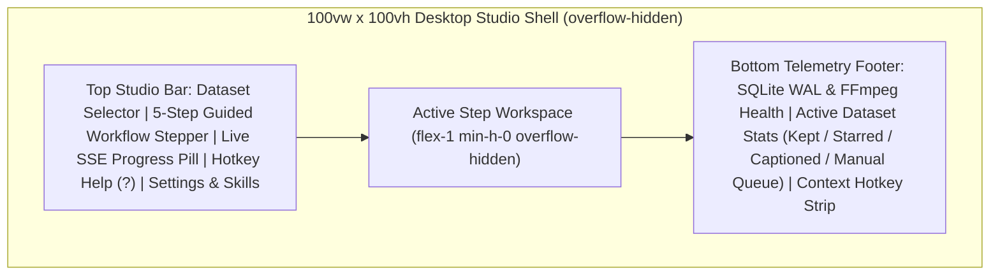
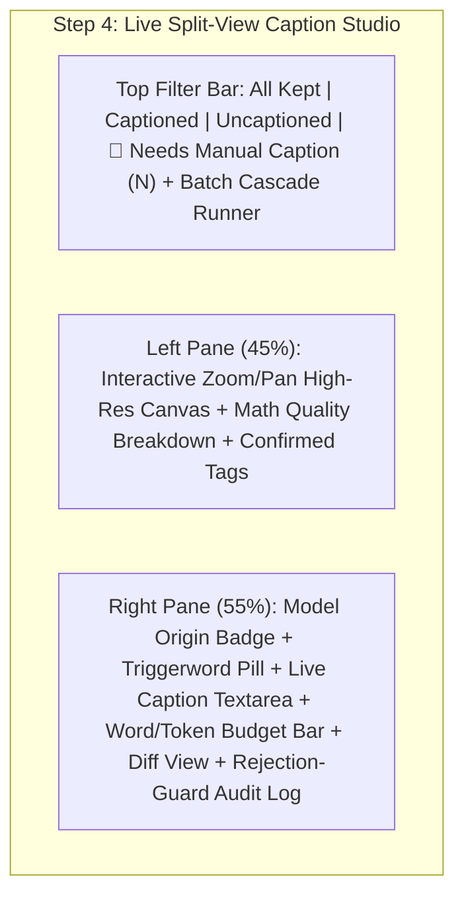

# Human-in-the-Loop (HITL) Interaction & UI/UX Design Specification

> **Document Version:** 2.0.0  
> **Frontend Stack:** Angular 22 (Standalone Components, Zoneless Signals, `ChangeDetectionStrategy.OnPush`) + TailwindCSS v4  
> **Design Paradigm:** Desktop-Grade Creative Studio (Adobe Lightroom Classic / DaVinci Resolve / Linear Dark-Mode Aesthetic)

---

## 1. Executive Summary & Design Philosophy

Building high-purity **LoRA training datasets** (for Flux, Krea 2, SD3.5, and Wan DiT architectures) requires curating hundreds of candidate frames or images, eliminating near-duplicates and motion blur, balancing visual distributions (aspect ratios, lighting keys, shot scales), and auditing dense prose captions for triggerword placement and VLM safety refusals.

Traditional web forms fail at this workload because **mouse-driven pagination and modal-heavy editing cause severe operator fatigue**. The **LoRA Dataset Studio** solves this through a **Human-in-the-Loop (HITL) Assisted Curation Architecture**:

1. **Deterministic Automation First, Human Override Always**: Mathematical computer vision ($Q(I)$ scoring, $O(N \log N)$ pHash/dHash/HSV clustering, `RuleBasedHeuristicPlugin` auto-tagging, and `RuleBasedStratifier`) and the 3-tier OpenRouter VLM cascade (`Primary -> Fallback 1 -> Fallback 2`) perform 90%+ of the heavy lifting automatically.
2. **Zero-Friction Keyboard-First Ergonomics**: Every high-frequency curation decision (Keep, Reject, Star, Quick-Tag `1–9`, Expand Duplicate Cluster `C`, Force Re-Caption `R`, Navigate `Arrow` keys) executes in `<16 ms` via a single keystroke without touching the mouse.
3. **Color-Neutral Dark Studio Canvas**: Inspired by **DaVinci Resolve** and **Adobe Lightroom**, the UI uses a calibrated dark neutral slate (`#0B0D11` canvas, `#12151C` surface cards, `#1E2330` 1px borders) so human perception of image exposure, chiaroscuro shadow detail, and color temperature is never biased by bright surrounding chrome.
4. **Full Transparency & Auditability**: No black-box decisions. Every thumbnail displays its exact mathematical quality telemetry ($Q$, Sharpness $S$, Exposure $E$, Entropy $H$), every caption displays its **Cascade Model Origin Badge** (`Primary`, `Fallback 1`, `Fallback 2`, or `Manual`), and every rejected VLM attempt is inspectable in the **Rejection-Guard Audit Drawer**.

---

## 2. Color System, Typography & Studio Layout Topology

### 2.1 Calibrated Dark-Mode Studio Palette

| Semantic Token | Hex / Value | Usage in Studio UI |
| :--- | :--- | :--- |
| `--studio-canvas` | `#090B0E` | Deep color-neutral background behind image grids and high-res pan/zoom viewport |
| `--studio-surface` | `#11141B` | Primary panel, sidebar, and card background |
| `--studio-elevated` | `#171B24` | Hover states, active table rows, drawer backgrounds |
| `--studio-border` | `#232936` |Crisp 1px structural dividers (`border-slate-800/80`) |
| `--studio-accent` | `#F97316` / `#EA580C` | Primary studio action accent (Amber/Orange focal ring & active step indicator) |
| `--state-keep` | `#10B981` (Emerald 500) | Approved / Kept item border, badge, and histogram bar |
| `--state-star` | `#F59E0B` (Amber 400) | Hero / Starred exemplar frame |
| `--state-reject` | `#EF4444` (Rose 500) | Rejected item & `Needs Manual Caption` alert badge |
| `--state-cluster` | `#6366F1` (Indigo 500) | Perceptual hash cluster badge & representative indicator |
| `--state-trigger` | `#38BDF8` (Sky 400) | Highlighted `trigger_word` token pill inside the caption editor |

### 2.2 Typography & Numeric Discipline
- **UI & Prose Font**: `Inter` / system sans-serif with relaxed line-height (`1.6`) in the caption editor for effortless scanning of 80–180 word Krea 2 paragraphs.
- **Telemetry & Code Font**: `JetBrains Mono` / monospace with `font-variant-numeric: tabular-nums` on all quality scores ($Q = 0.89$), timestamps (`00:01:24.40`), pHash hex strings (`f0e19a3c...`), word/token counters (`118 / 140 words`), and RRF/BM25 retrieval scores.

### 2.3 Full-Viewport Non-Scrolling Shell (`100vw x 100vh`)

---

## 3. Guided 5-Step Workflow Stepper & Navigation Architecture

The top navigation bar anchors the operator in a linear, repeatable 5-stage pipeline while allowing non-destructive jumping between stages at any time:

| Step | Stage Name | Core User Goal | Key Backend Endpoints |
| :--- | :--- | :--- | :--- |
| **Step 1** | **Ingest & Extract** | Select `/data/input` image folder or video file, configure `trigger_word`, FFmpeg extraction mode (`scene`, `iframe`, `interval`), and pHash Hamming threshold $\tau$. | `GET /api/v1/fs/browse` `POST /api/v1/datasets` `POST /api/v1/datasets/{id}/ingest` `POST /api/v1/datasets/{id}/cluster` |
| **Step 2** | **Auto-Filter & HITL Triage** | Rapidly curate candidate frames via keyboard (`Space`, `X`, `S`, `1–9`), inspect mathematical quality badges ($Q, S, E, H$), and compare/swap near-duplicate clusters (`C`). | `GET /api/v1/datasets/{id}/items` `POST /api/v1/datasets/{id}/items/batch-triage` `POST /api/v1/datasets/{id}/clusters/{cid}/representative` |
| **Step 3** | **Tagging & Stratification** | Run deterministic CV heuristic auto-tagger (`rule_cv_heuristics`), assign category tags, inspect dataset balance histograms & outliers, and auto-stratify to target count $N$. | `POST /api/v1/datasets/{id}/autotag` `POST /api/v1/datasets/{id}/items/batch-tag` `GET /api/v1/datasets/{id}/stratification` `POST /api/v1/datasets/{id}/stratify` |
| **Step 4** | **OpenRouter Caption & Review** | Run 3-tier VLM cascade with Krea 2 Master Skills, filter by **`Needs Manual Caption`**, edit captions in Live Split-View with triggerword highlighting, diff view, and rejection logs. | `POST /api/v1/datasets/{id}/caption` `PUT /api/v1/items/{media_id}/caption` `GET /api/v1/datasets/{id}/rejections` |
| **Step 5** | **Export & LoRA Prompt Studio** | Export normalized `.png`/`.jpg` + `.txt` + `metadata.jsonl` + `dataset_card.json` + `.zip`, and synthesize grounded Krea 2 prompts via hybrid FTS5 BM25 + SVD-128 RAG. | `POST /api/v1/datasets/{id}/export` `GET /api/v1/datasets/{id}/export/download` `POST /api/v1/rag/index` `POST /api/v1/rag/retrieve` `POST /api/v1/rag/generate` |
| **Modal / Drawer** | **System Settings & Skill Manager** | Configure OpenRouter API key, test connectivity, set Primary/Fallback 1/Fallback 2 models, tune temperature/tokens, and edit/version Krea 2 Master Skills. | `GET /api/v1/settings` `PUT /api/v1/settings` `POST /api/v1/settings/test-openrouter` `GET /api/v1/skills` `POST /api/v1/skills` |

---

## 4. Detailed View Specifications

### 4.1 Step 1 View: Dual-Path Ingest (`Pre-Sorted Images` & `Video via FFmpeg`)
- **Interactive `/data/input` File Browser**:
  - Displays current container path, clickable parent/child directories, detected image counts (`.png`, `.jpg`, `.webp`), and video files (`.mp4`, `.mkv`, `.mov`, `.webm`).
  - Clicking a folder with images automatically sets `source_type = 'image_folder'`; clicking a video file sets `source_type = 'video'`.
- **Dataset & Triggerword Configuration Card**:
  - **Dataset Name & Target Size**: e.g., `Evelyn_Krea2_Char_v1`, Target Count `150`.
  - **Triggerword & Position**: Input for `trigger_word` (e.g., `ohwx_woman` or `restrained_elegance`) and 3-way segmented pill selector for `trigger_position`:
    - `prefix` (Token-0 anchor: `"{trigger_word} Photograph of..."`)
    - `suffix` (`"..., {trigger_word}."`)
    - `natural_integration` (Weaved into opening subject clause)
  - **Master Skill Preset**: Dropdown binding to `krea2_character_v1`, `krea2_concept_v1`, or `krea2_style_v1`.
- **Non-ML Extraction & Deduplication Controls**:
  - When `source_type === 'video'`:
    - **Scene Change (`scene`)**: `select='gt(scene,0.15)'` with slider for scene threshold $\in [0.05, 0.50]$.
    - **I-Frame Keyframes (`iframe`)**: Ultra-fast keyframe-only demuxing (`-skip_frame nokey`).
    - **Interval + Window-Peak (`interval`)**: Sample interval $\Delta t \in [0.1\text{s}, 10.0\text{s}]$ + window-peak sharpness selector $M \in [1, 10]$.
  - **Perceptual Hash Deduplication Slider**:
    - 64-bit pHash Hamming threshold $\tau_p \in [0, 16]$ (default `6`) + live Re-Cluster button (`POST /api/v1/datasets/{id}/cluster`) that collapses near-duplicates in $O(N \log N)$ without re-extracting frames.

---

### 4.2 Step 2 View: Zero-Friction Keyboard-First Triage Mode & Cluster Comparison

#### A. Keyboard-First Navigation & Action Matrix
The Step 2 Triage View registers a `@HostListener('window:keydown', ['$event'])` listener (automatically suppressed when an `<input>`, `<textarea>`, or `<select>` has focus):

| Keystroke | Action | UX Feedback & State Transition |
| :--- | :--- | :--- |
| `ArrowRight` / `ArrowLeft` | Move focus to next / previous item | Instant orange focus ring (`ring-2 ring-orange-500`), smooth `scrollIntoView({block: 'nearest'})` |
| `ArrowDown` / `ArrowUp` | Move focus down / up by grid column stride | Adapts dynamically to current grid column count |
| `Space` or `Enter` | **Keep / Accept** active item | Sets `curation_state = 'keep'`, flashes emerald badge, auto-advances focus to next item |
| `Backspace` or `X` | **Reject** active item | Sets `curation_state = 'reject'`, dims card opacity to `45%`, auto-advances focus |
| `S` | **Star** active item (Hero exemplar) | Sets `curation_state = 'star'`, highlights gold star badge, auto-advances focus |
| `1` – `9` | **Quick-Tag** active item | Toggles the corresponding numbered quick-tag pill (`1: close_up`, `2: full_body`, `3: chiaroscuro`, etc.) on the active item with zero mouse movement |
| `C` | **Toggle Cluster Comparison Drawer** | Opens/closes the bottom/right Near-Duplicate Cluster Drawer for the active item's `cluster_id` |
| `R` | **Force Re-Caption (Cascade)** | Triggers OpenRouter 3-tier cascade captioning for the active item |
| `?` | **Toggle Shortcut Cheat-Sheet** | Displays modal overlay of all studio keyboard shortcuts |

#### B. Visual Quality Badges on Every Thumbnail Card
Each thumbnail card renders 384px WebP previews served from the native Linux volume (`/api/v1/media/{id}/thumbnail`) overlaid with non-occluding glassmorphic telemetry badges:
- **Top-Left**: **Curation Status Pill** (`KEEP`, `STAR`, `CANDIDATE`, `AUTO-REJECTED: motion_blur`, `DUPLICATE`).
- **Top-Right**: **Composite Quality Badge ($Q$)** color-coded by tier:
  - $Q \ge 0.75$: Emerald (`bg-emerald-950/90 text-emerald-300 border-emerald-500/40`)
  - $0.50 \le Q < 0.75$: Amber (`bg-amber-950/90 text-amber-300 border-amber-500/40`)
  - $Q < 0.50$: Rose (`bg-rose-950/90 text-rose-300 border-rose-500/40`)
- **Bottom Telemetry Bar**:
  - Sharpness $S$ (`Sharp: 0.91`, tooltip shows raw $L_{\text{tile}}$ and Tenengrad $T$), Exposure $E$ (`Exp: 0.86`, luma $\mu_I$), and Entropy $H$ (`5.9b`).
  - **Cluster Size Badge**: When `cluster_size > 1`, displays an interactive Indigo pill `Cluster #12 (4 frames)` — clicking or pressing `C` opens the Near-Duplicate Cluster Comparison Drawer.

#### C. Expandable Near-Duplicate Cluster Comparison Drawer
When toggled via `C` or clicking a cluster badge:
- Fetches all members of `cluster_id` (`GET /api/v1/datasets/{id}/items?cluster_id={cid}&include_duplicates=true`).
- Displays the current winning **Cluster Representative** ($i^* = \arg\max_{i \in C_k} Q(I_i)$, marked with a Crown/Representative badge) on the left alongside all `duplicate_hidden` sibling frames on the right.
- Highlights metric deltas ($\Delta Q$, $\Delta \text{Sharpness}$, pHash Hamming distance) and provides a one-click **"Promote to Representative"** button (`POST /api/v1/datasets/{id}/clusters/{cid}/representative`) that atomically promotes the chosen sibling to `keep` and demotes the previous representative to `duplicate_hidden`.

---

### 4.3 Step 3 View: Tagging & ML-Ready Stratification

1. **One-Click Non-ML Heuristic Auto-Tagger**:
   - Invokes `POST /api/v1/datasets/{id}/autotag` (`plugin_id = 'rule_cv_heuristics'`).
   - Populates deterministic tags across `shot_scale` (`portrait_tall`, `square`, `landscape_wide`, `close_focus_bokeh`, `full_scene_deep_dof`), `lighting` (`low_key_dark`, `chiaroscuro_high_contrast`, `balanced_midtone`, `high_key_bright`), and `style_element` (`warm_tungsten_cast`, `cool_daylight_cast`, `monochrome_desaturated`, `vivid_saturated`).
2. **Interactive Quick-Tag Matrix & Batch Tagger**:
   - Organizes tags into the 8 canonical categories (`pose`, `lighting`, `outfit`, `expression`, `style_element`, `shot_scale`, `environment`, `equipment`).
   - Supports multi-select batch tag assignment and removal (`POST /api/v1/datasets/{id}/items/batch-tag`).
3. **Visual Distribution Histograms & Outlier Detection**:
   - Renders pure CSS/SVG horizontal distribution bar charts from `GET /api/v1/datasets/{id}/stratification`:
     - **Aspect Ratio Distribution**: Portrait vs. Square vs. Landscape.
     - **Lighting & Luminance Key Distribution**: Low-Key, Chiaroscuro, Midtone, High-Key.
     - **Color Temperature & Saturation Balance**: Warm, Neutral, Cool, Monochrome, Vivid.
     - **Temporal Decile Spread** (10 timeline bins `[0%..100%]` for video datasets).
     - **Tag Category Coverage** & **Actionable Recommendations** (e.g., *"Bucket 'portrait_tall' is over-represented (78% of kept items)"*).
4. **One-Click Auto-Balance / Stratify Selection**:
   - Configurable `target_count` (e.g., `150`) and `diversity_weight` slider $\in [0.0, 1.0]$ (balancing pure quality score $Q$ against tag/temporal entropy).
   - Clicking **"Auto-Balance Dataset"** calls `POST /api/v1/datasets/{id}/stratify`, promoting under-represented high-quality candidates and flagging visual outliers with an `Outlier` badge.

---

### 4.4 Step 4 View: Live Split-View Caption Editor & OpenRouter Cascade Review

1. **Filter Tabs with Dedicated `"Needs Manual Caption"` Queue**:
   - Filter pills for `All Kept`, `Captioned`, `Uncaptioned`, and a high-visibility rose alert tab **`Needs Manual Caption`** (`caption_status === 'needs_manual_caption'`) surfacing any item where Primary, Fallback 1, and Fallback 2 all failed or refused.
2. **Left Pane — Interactive High-Res Inspector**:
   - Loads native resolution `/api/v1/media/{id}/full` with interactive **Zoom (`1x` to `4x`) & Pan drag controls** so the annotator can inspect fine fabric textures, jewelry, or background details while editing the caption.
   - Displays compact mathematical quality breakdown and confirmed tags for grounding.
3. **Right Pane — Live Caption Editor & Cascade Audit**:
   - **Model Origin Badge**: Clearly states which cascade tier produced the active caption:
     - Emerald badge: `Primary (google/gemma-4-31b-it)`
     - Amber badge: `Fallback 1 (deepseek/deepseek-v4.1-flash) — Escalated`
     - Purple badge: `Fallback 2 (x-ai/grok-4.7) — Final Escalation`
     - Sky badge: `Manual Override (Human Approved)`
   - **Color-Highlighted Triggerword Preview**:
     - Renders a live formatted preview above/below the editor where every occurrence of `trigger_word` (e.g., `restrained_elegance`) is highlighted as a distinct Sky-Blue token pill (`bg-sky-500/20 text-sky-300 border border-sky-400/50 px-1.5 py-0.5 rounded font-mono`), immediately confirming Token-0 prefix or natural integration compliance.
   - **Live Word & Token Budget Meter**:
     - Counts words and estimated CLIP/T5 tokens in real time against the active skill's target window (`min_words: 80` .. `max_words: 140`, `hard_max_words: 270`), turning green when inside the ideal Krea 2 prose window and amber/red if under-length or risking token truncation.
   - **Side-by-Side / Inline Word Diff View**:
     - Toggling **"Diff View"** computes a deterministic word-level LCS diff between the previous VLM/saved caption and the current edited or regenerated caption, rendering additions in emerald (`+added`) and deletions in strikethrough rose (`-removed`).
   - **Rejection-Guard Audit Log Inspector**:
     - Queries `GET /api/v1/datasets/{id}/rejections?media_id={id}` and displays every rejected cascade attempt (`cascade_layer`, `model_attempted`, `rejection_type` such as `refusal_regex` or `truncated_length`, exact matched regex reason, and the raw 500-char VLM snippet).

---

### 4.5 Step 5 View: Standardized Dataset Export & Local "LoRA Prompt Studio" (RAG)

 Step 5 is organized into two synchronized studio workspaces:

#### Workspace A: Standardized Dataset Exporter
- **Normalization & Latent Grid Controls**:
  - Image Format: `.png` (lossless 24-bit sRGB) or `.jpg` (Q95).
  - Max Edge Clamp: `1024px`, `1536px`, or `2048px` (Lanczos-4 downscaling, never upscales).
  - **Snap to Multiple of 16 (`snap_multiple_16 = true`)**: Ensures exact DiT patch grid compatibility for Flux / Krea 2 / Wan.
  - Triggerword enforcement check before writing `.txt` files.
- **One-Click Export & `.zip` Download**:
  - Calls `POST /api/v1/datasets/{id}/export` and enables a direct download button bound to `GET /api/v1/datasets/{id}/export/download`.
- **Interactive `dataset_card.json` Audit Viewer**:
  - Renders the generated dataset card metrics (resolution buckets, aspect ratios, cascade model shares, average word count, and `metadata.jsonl` path).

#### Workspace B: Local Non-ML "LoRA Prompt Studio" (RAG)
- **Index Builder Bar**:
  - One-click **"Build / Refresh Local RAG Index"** (`POST /api/v1/rag/index`) using either `tfidf_svd_128` (128-D scikit-learn LSA, zero external API calls, `<150 ms`) or `openrouter_embedding`.
- **Grounded Scene Composer & Multi-LoRA Trigger Selector**:
  - Natural language scene description input (e.g., *"dramatic chiaroscuro studio portrait in tailored dark wool coat near rain-streaked window"*).
  - **Character Triggerword** + **Style/Concept Triggerword** selectors so users can combine multiple trained LoRAs in a single prompt.
  - **Retrieval Mode Selector**: `Hybrid (FTS5 BM25 + SVD-128 Cosine RRF)`, `FTS5 Lexical BM25 Only`, or `Dense LSA Cosine Only`, plus MMR diversity slider $\lambda \in [0.0, 1.0]$.
  - **Interactive Tag Category Filter Pills**: Filter retrieval by confirmed dataset tags (`lighting`, `pose`, `outfit`, `shot_scale`, `style_element`).
- **Retrieved Reference Captions Inspector**:
  - Displays the top-$K$ retrieved training exemplars with their thumbnail preview, **RRF Combined Score**, **BM25 Lexical Score**, **Cosine Similarity $\cos(\theta)$**, matched tags, and 4-domain taxonomy breakdown (`equipment`, `surroundings`, `position`, `lighting`).
- **3-Archetype Krea 2 Prompt Synthesizer**:
  - Calls `POST /api/v1/rag/generate` and renders three copy-ready cards:
    - **Archetype A — Concise Tag List** (`25–50 tokens`)
    - **Archetype B — Short Anchor Prose** (`50–120 tokens`)
    - **Archetype C — Dense Visual Narrative** (`180–280 tokens`)
  - Includes one-click **Copy to Clipboard**, token count badges, and deterministic Krea 2 sludge/linter validation badges.

---

### 4.6 System Settings & Versionable Master Skill Manager

Accessible from any step via the top-right **Settings & Skills** button:
1. **OpenRouter API & 3-Tier Cascade Configuration**:
   - Masked API key input (`sk-or-v1-...`) with **"Test Connection"** button (`POST /api/v1/settings/test-openrouter`) showing live key validity and credit usage (`usage_usd` / `limit_usd`).
   - Editable model identifiers with sensible defaults:
     - `primary_model`: `google/gemma-4-31b-it`
     - `fallback_model_1`: `deepseek/deepseek-v4.1-flash`
     - `fallback_model_2`: `x-ai/grok-4.7`
   - Global sliders for `max_tokens` (`64..4096`, default `600`) and `temperature` (`0.0..2.0`, default `0.4`).
2. **Rejection-Guard Custom Regex Editor**:
   - View built-in refusal/preamble rules and add/remove custom regex patterns persisted in `system_settings.custom_rejection_regexes`.
3. **Quality Scoring Weight Sliders ($w_S, w_E, w_H, w_C$)**:
   - Customize the mathematical composite score formula $Q(I) = w_S S + w_E E + w_H H + w_C C$.
4. **Versionable Master Skill Editor (`krea2_character`, `krea2_concept`, `krea2_style`)**:
   - Inspect and edit the `system_prompt_template`, `user_prompt_template`, `glossary_template`, `min_words`, `max_words`, and `discouraged_regexes`.
   - Clicking **"Save as New Skill Version"** calls `POST /api/v1/skills`, incrementing `version` (`v1 -> v2`) in SQLite so historical caption audit logs retain exact provenance of which prompt version generated each caption.
